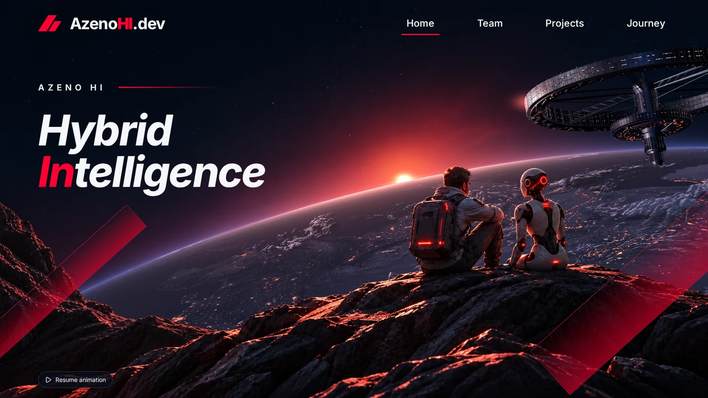

# AzenoHI — plan realizacji i instrukcja dla Codexa

Data analizy: 24 listopada 2026 r. Dokument stanowi plan wykonania strony; nie oznacza, że repozytorium, aplikacja lub wdrożenie zostały już utworzone.

## 1. Cel i ustalone założenia

Zbuduj stronę portfolio zespołu **AzenoHI**, wizualnie zgodną z dostarczonymi makietami. Marka widoczna w interfejsie: **AzenoHI.dev**. Nazwa repozytorium: **azenohi**. Katalog roboczy wskazany przez użytkownika: `/home/lipov/projects/azeno_hi`.

Zakres obejmuje:

- cztery pozycje głównego menu: Home, Team, Projects, Journey;
- podstronę projektu Risk Miner;
- autentyczną animację obrotu Ziemi i stacji kosmicznej oraz oświetlenia stacji, zgodną z lokalnym filmem;
- responsywny interfejs z tekstami po angielsku;
- własne, niezależne repozytorium na koncie użytkownika, z jedną gałęzią `main`;
- profesjonalny angielski README z grafiką, ikonami faktycznie używanych technologii i działającą instrukcją uruchomienia;
- lokalną weryfikację funkcjonalną, wizualną, dostępności i działania animacji.

Użytkownik ma zgodę na wykorzystanie szablonu `pawelkonior/risk-engine`. Użytkownik podał też, że docelowy Codex ma pełny dostęp do komputera. Wykorzystaj dostępne narzędzia do odczytania materiałów, odtworzenia filmu, uruchomienia aplikacji i sprawdzenia jej w przeglądarce. Zwykłe decyzje implementacyjne podejmuj samodzielnie, zgodnie z tym planem.

## 2. Materiały — rzeczywiste, sprawdzone ścieżki

Wszystkie poniższe pliki zostały odnalezione w lokalnym katalogu użytkownika:

| Plik źródłowy | Rola | Proponowane miejsce w projekcie |
| --- | --- | --- |
| `/home/lipov/Downloads/home.png` | Makieta Home | `design/reference/home.png` |
| `/home/lipov/Downloads/team.png` | Makieta Team | `design/reference/team.png` |
| `/home/lipov/Downloads/projects.png` | Makieta Projects | `design/reference/projects.png` |
| `/home/lipov/Downloads/journey.png` | Makieta Journey | `design/reference/journey.png` |
| `/home/lipov/Downloads/risk_miner.png` | Makieta szczegółów Risk Miner | `design/reference/risk_miner.png` |
| `/home/lipov/Downloads/animated_front_page.mp4` | Referencja animacji Home | `design/reference/animated_front_page.mp4` |

Skopiuj te konkretne pliki do projektu, zachowując oryginały w Downloads. Nie przenoś całej zawartości Downloads. Kopiowanie pozwala wrócić do oryginałów i nie wymaga ingerencji w inne pliki użytkownika. Po kopiowaniu porównaj SHA-256 każdej pary.

**Nowa miniatura Risk Miner została już wygenerowana przez imagegen:**

`/home/lipov/projects/azeno_hi/generated_images/exec-de366445-3675-4c01-ba93-5ba28ec26ee0.png`

Przed użyciem obejrzyj ją. To ilustracja z mapą Polski, budową, czerwonymi połączeniami i panelami analitycznymi, przeznaczona do karty projektu. Zachowaj plik źródłowy. Przygotuj zoptymalizowany wariant dla `web/public/images/projects/risk-miner.webp`, sprawdzając przezroczystość i czytelność w rozmiarze karty. Jeżeli wymaga zmiany kompozycji lub usunięcia tła, użyj imagegen do edycji. Samo zapisanie obrazu w katalogu nie jest ukończeniem zadania — podepnij go do rzeczywistej karty Projects i sprawdź renderowanie.

Materiały w `design/reference/` są wzorcem dla implementacji. Nie wrzucaj ich automatycznie do paczki produkcyjnej. W `web/public/` umieszczaj wyłącznie potrzebne, zoptymalizowane zasoby.

### Obowiązkowa analiza filmu

Przy przygotowywaniu tego planu nie udało się odtworzyć filmu w ograniczonym środowisku. Nie przyjmuj więc żadnych opisanych niżej prędkości jako pomiaru nagrania.

Docelowy Codex ma obejrzeć lokalny `animated_front_page.mp4`. Użyj dostępnego odtwarzacza lub FFmpeg/ffprobe. Jeśli tych narzędzi nie ma, zainstaluj je w środowisku, w którym masz do tego uprawnienia, albo użyj dostępnego dekodera wideo. Nie proś użytkownika o ponowne przesłanie pliku, skoro znasz jego lokalną ścieżkę.

Przykładowe komendy odczytu:

```bash
ffprobe -v error -show_entries format=duration:stream=width,height,r_frame_rate -of json /home/lipov/Downloads/animated_front_page.mp4
ffmpeg -i /home/lipov/Downloads/animated_front_page.mp4 -vf "fps=1,scale=960:-1" /tmp/azenohi-motion/frame-%03d.png
```

Przed drugą komendą utwórz katalog `/tmp/azenohi-motion`. Obejrzyj początek, środek i koniec oraz sekwencję kolejnych klatek. Zapisz w `docs/motion-reference.md`:

1. czas trwania, proporcje, rozdzielczość i liczbę klatek na sekundę;
2. kierunek i widoczną oś obrotu Ziemi;
3. kierunek i oś obrotu stacji — odróżnij obrót własny od ruchu po orbicie i od ruchu kamery;
4. zachowanie świateł: stałe okna, pulsowanie, miganie, odbicia;
5. ruch kamery, foregroundu i postaci, jeżeli rzeczywiście występuje;
6. zachowanie początku i końca klipu oraz ewentualne cięcie pętli;
7. co trzeba odtworzyć dokładnie, a co jest świadomym uproszczeniem.

Nie zakładaj, że film sam w sobie zawiera gotową pętlę ani oddzielne warstwy.

## 3. Wynik analizy szablonu

Sprawdzone źródło: https://github.com/pawelkonior/risk-engine

Sprawdzony `main`: `14b2ec9fdd82ac88ce50edb538efde0126f73a3c`. Przed implementacją odczytaj ponownie aktualny SHA i zanotuj, jeśli jest inny.

Na dzień analizy repozytorium zawierało `main` oraz trzy gałęzie testowe:

- `auc-24/frontend-menu`;
- `auc-28/frontend-status-menu`;
- `codex/auc-27-frontend-menu`.

**Gałąź `main` zawiera starter aplikacji, a nie ukończony interfejs Risk Miner.** Frontend ma prostą stronę startową i przykładowy kod CRUD. Grafiki użytkownika trzeba odtworzyć jako nowy interfejs.

| Element źródła | Co faktycznie znaleziono | Decyzja dla AzenoHI |
| --- | --- | --- |
| `web/` | React, TypeScript, Vite | Zachować jako bazę frontendu |
| Narzędzia jakości | Oxlint, Prettier, Vitest, Testing Library, Playwright, axe | Zachować i dostosować do strony |
| `web/src/features/items/` | Przykładowy CRUD | Usunąć wraz z niepotrzebnymi importami i testami tego przykładu |
| React Query i klient API | Obsługa danych backendu | Usunąć, jeśli po audycie nie mają żadnego zastosowania |
| Zod | Walidacja | Zostawić tylko, jeśli faktycznie waliduje dane treści lub inne wejście |
| `api/` | FastAPI, bazy danych i logika AI | Niepotrzebne do obecnego zakresu; usunąć w etapie adaptacji |
| Compose | Backend i rozbudowany zestaw usług AI | Usunąć zależności od tych usług; opcjonalny kontener statycznego frontendu |
| LangGraph, Ollama, Neo4j, Qdrant, Langfuse i usługi pomocnicze | Zaplecze aplikacji AI | Nie uruchamiać ani nie wdrażać dla portfolio |
| `.specify/`, instrukcje i przydatne narzędzia agenta | Gotowy workflow Spec Kit | Zachować i dostosować do zakresu frontendu |
| `web/vercel.json` | Konfiguracja builda Vite | Zachować jako punkt wyjścia, dostosować routing |
| Root Makefile i hooki | Kontrole frontendu oraz backendu | Przepisać polecenia zależne od usuwanego API |

W odczytanym `web/package.json` były: React `19.3.1`, TypeScript `7.0.2`, Vite `8.3.8`, npm `12.2.2`, wymagany Node `26.x`. Są to wersje zapisane w analizowanym szablonie, a nie polecenie instalowania najnowszych wersji bez sprawdzenia. Odczytaj `.nvmrc`, manifest i lockfile; korzystaj ze zgodnego zestawu i `npm ci`. Dodatkowe biblioteki dobierz pod kątem peer dependencies. Nie stosuj `--force` lub `--legacy-peer-deps` jako naprawy niezgodności.

W źródle testy Playwright uruchamiają również odizolowane API przez `web/scripts/e2e-api.py`. Wraz z usunięciem API trzeba zmienić `web/playwright.config.ts`, testy CRUD, proxy Vite, Nginx, zmienne środowiskowe, Makefile i hooki. Pozostawienie tych odwołań jest błędem, nawet jeśli sam ekran Home działa.

Źródłowa konstytucja wymaga lokalnej kontroli jakości i nie przewiduje GitHub Actions. Zachowaj ten model; nie dodawaj Actions ani odznaki udającej działające CI. Dostosowanie zakresu do samego frontendu zapisz w ADR oraz instrukcjach projektu. Nie usuwaj kontroli jakości tylko po to, aby uzyskać zielony wynik.

Nie znaleziono rootowego `LICENSE` w analizowanym drzewie. Użytkownik potwierdził zgodę na wykorzystanie template'u. Zachowaj istniejące informacje o autorstwie i licencje pozostawionych elementów zewnętrznych. Nie dopisuj automatycznie licencji MIT do całego kodu ani cudzych grafik.

## 4. Repozytorium — niezależna kopia z jednym main

### Kolejność bootstrapu

1. Sprawdź bieżący katalog, istniejące pliki, status Gita i zdalne adresy. Nie kasuj plików planu, referencji ani wygenerowanej ilustracji. Nie usuwaj `.git` istniejącego projektu ani zarządzanego worktree.
2. Sprawdź uwierzytelnionego użytkownika GitHub. Oczekiwane konto: `Kinetics20`. Jeżeli aktywne konto jest inne, nie twórz projektu na nim automatycznie.
3. Pobierz **wyłącznie `main`** źródła do nowego katalogu tymczasowego: `git clone --single-branch --branch main --no-tags ...`. Nie potrzebujesz pobierać gałęzi testowych i później ich kasować.
4. Zapisz URL źródła i pełny SHA. Wyeksportuj pliki z tego commita przez `git archive` do pustego katalogu stagingowego. To daje snapshot bez źródłowego `.git`, branchy i powiązań remote.
5. Przejrzyj snapshot, a następnie włącz go do katalogu projektu bez nadpisywania istniejących plików użytkownika i konfiguracji środowiska. Jeśli cel zawiera już historię, zachowaj ją. Świeże `git init -b main` wykonuj wyłącznie dla rzeczywiście nowego repozytorium.
6. Zrób pierwszy commit importu sprawdzonego startera. Zapisz pochodzenie w `docs/template-origin.md`: autor, URL, źródłowy SHA i informacja o wykorzystaniu za zgodą. Zachowaj ten punkt w historii, aby można było wrócić do template'u.
7. Utwórz zwykłe repozytorium `Kinetics20/azenohi`, nie fork i nie GitHub Project board. Jeśli repo już istnieje, sprawdź je i kontynuuj bez nadpisywania jego historii. Gdy widoczność nie została ustalona, przyjmij `private` na czas pracy; nie zmieniaj istniejącej widoczności.
8. Jedyny adres `origin` w docelowym repo ma wskazywać konto użytkownika. Wypchnij tylko `main`. Sprawdź default branch, `isFork`, zdalne heads i zgodność lokalnego SHA ze zdalnym.
9. Dopiero po zapisie punktu startowego wykonuj kolejne commity adaptacji i strony. To oddziela import template'u od własnej implementacji.

Źródłowego repozytorium Pawła nie modyfikuj. Nie wykonuj na nim żadnego `push --delete`, zmiany ustawień ani usuwania branchy. Nie używaj `git push --mirror` i `git push --all`. Samo usunięcie gałęzi nie usuwa ich wcześniej scalonego kodu; o zakresie kodu decyduje audyt plików, a nie nazwa brancha.

W tym projekcie zachowuj `main` jako jedyną gałąź zgodnie z wymaganiem użytkownika. Jeśli narzędzie Spec Kit domyślnie tworzy branch, użyj obsługiwanego trybu wskazania katalogu specyfikacji bez dodatkowej gałęzi albo przygotuj artefakty ręcznie. Nie zmieniaj tego wymagania po cichu.

## 5. Architektura i narzędzia

Rekomendacja: **statyczny frontend React + TypeScript + Vite**, dane treści w lokalnych modułach, wspólna warstwa komponentów i jedna scena 3D w hero. Backend nie jest potrzebny do przedstawionych ekranów.

| Potrzeba | Narzędzie | Zastosowanie |
| --- | --- | --- |
| Import i wersjonowanie | Git, GitHub connector / `gh` | Snapshot `main`, własne repo, małe commity |
| Interfejs | Istniejący React + TypeScript + Vite | Layout, strony, dane i komponenty |
| Style | CSS variables, CSS Grid/Flexbox, istniejący CSS | Własny wygląd zgodny z makietami; bez zbędnej migracji na inny system |
| Routing | React Router w zgodnej wersji | Home, Team, Projects, Journey, szczegóły projektu, 404 |
| Scena 3D | Three.js + `@react-three/fiber` | Obrót Ziemi i stacji, kamera, materiały i światło |
| Pomocnicze funkcje 3D | Wybrane elementy `@react-three/drei` | Ładowanie zasobów; dodawać tylko potrzebne funkcje |
| Ikony UI | Lucide React lub własne małe SVG | Spójne ikony; SVG logo według makiety |
| Grafiki | imagegen | Ilustracje i przygotowanie warstw referencyjnych, bez wypalonych napisów |
| Film | ffprobe, FFmpeg, odtwarzacz | Analiza parametrów, klatek i ruchu |
| Modele | Proceduralne siatki Three.js; Blender opcjonalnie | Stacja; Blender tylko jeśli poprawi potrzebne detale |
| Weryfikacja | Istniejący Vitest, Testing Library, Playwright, axe | Zachowania, dostępność, przeglądarki, porównania wizualne |
| Dokumentacja techniczna | Context7 i oficjalne dokumentacje | API zgodne z faktycznie zainstalowanymi wersjami |

Nie dodawaj FastAPI, PostgreSQL, CMS, logowania, chatbota, formularza kontaktowego ani usług AI bez nowego wymagania funkcjonalnego. Opisy prezentowanych projektów mogą zawierać ich własny stack — nie oznacza to, że AzenoHI ma go instalować.

Proponowane obszary kodu: `web/src/app/`, `web/src/pages/`, `web/src/components/layout/`, `web/src/components/projects/`, `web/src/components/team/`, `web/src/components/journey/`, `web/src/components/scene/`, `web/src/data/`, `web/src/styles/` oraz `web/public/images/`, `web/public/models/`, `web/public/textures/`.

Zachowaj istniejący katalog `web`; nie inicjalizuj równolegle kolejnej aplikacji React w root.

## 6. Specyfikacja wyglądu i podstron

### Wspólne zasady

- Makiety określają kompozycję: ciemny granat, prawie czarne powierzchnie, białe napisy, czerwone akcenty, ukośne pasy, przestrzeń kosmiczna i mocne nagłówki w kursywie.
- Orientacyjne tokeny do dostrojenia: tło `#070D19`, powierzchnia `#101321`, akcent `#FF002B`, tekst `#F6F7FB`, tekst pomocniczy `#ADB0C1`. Traktuj je jako punkt wyjścia, nie jako zmierzone kolory źródła.
- Nagłówek: logo po lewej, Home / Team / Projects / Journey po prawej, czerwone podkreślenie aktywnej strony. Logo prowadzi do Home.
- Wszystkie nagłówki, opisy, nazwiska, odznaki, linki i przyciski mają być prawdziwym HTML. Nie implementuj całej strony jako jednego PNG z niewidocznymi hotspotami.
- Dobierz legalnie dostępny font o podobnym kroju i kursywie. Zadbaj o stabilne ładowanie i czytelność na telefonie.
- Wprowadzaj treść przez dane: `projects`, `teamMembers`, `milestones`, konfigurację nawigacji. Nie duplikuj tych samych informacji w wielu komponentach.
- Na mniejszych ekranach zachowaj hierarchię: mniej kolumn, czytelny tekst, odpowiednie kadrowanie tła, dostępne menu mobilne.

### Home — `/`

Odtwórz `home.png`: nagłówek „AZENO HI”, duży „Hybrid Intelligence”, czerwony akcent w słowie Intelligence, Ziemia z jasnym horyzontem, stacja w prawej górnej części, człowiek i robot na skalnym pierwszym planie. Położenie napisów ma pozostawiać czytelne tło i nie zasłaniać postaci.

Scena jest dekoracją, a treść i nawigacja działają również przed jej załadowaniem oraz bez WebGL. Dodaj dyskretny, dostępny przełącznik zatrzymania i wznowienia animacji.

### Team — `/team`

Odtwórz „OUR TEAM”, „People × AI”, tło kosmiczne i układ kart z `team.png`. Nazwiska/imiona i kolejność mogą zostać przepisane z makiety do danych wersji demonstracyjnej. Nie dopisuj biografii, ról, nazwisk, profili społecznościowych ani danych kontaktowych, których nie dostarczono.

Jeżeli brakuje osobnych portretów, przygotuj zasoby na podstawie dostarczonej makiety lub oznacz w dokumentacji, że pochodzą z makiety. Nie twórz nowych przypadkowych twarzy jako rzekomych członków zespołu. Licznik „14+” traktuj jako treść makiety do potwierdzenia przed publiczną publikacją; nie wyliczaj go fałszywie na podstawie 12 widocznych kart. Karty nie muszą być klikane, jeśli nie mają rzeczywistego celu.

### Projects — `/projects`

Zachowaj „OUR PROJECTS” i „From Hackathons to Real Impact”, tło oraz siatkę 3 kolumn na dużym ekranie. Kolejność:

1. CapTrace;
2. Done;
3. PrivyMeet;
4. Productivity Suite;
5. RiskTrace Control Tower;
6. **Risk Miner — w miejscu „More Projects in Progress”.**

Risk Miner otrzymuje wygenerowaną miniaturę w tym samym stylu, tytuł „Risk Miner”, opis „AI for Public Investment Risk” i oznaczenie „HackNation”. Rok edycji wynika z kontekstu użytkownika: 2026. Nie dopisuj miejsca na podium ani nagrody Risk Miner.

Miniatura znajduje się po prawej stronie karty, tekst po lewej, pasek wydarzenia i strzałka na dole. Przejście karty Risk Miner prowadzi do `/projects/risk-miner`. Dla pozostałych projektów zapewnij prawdziwą dostępną stronę/dialog z dostarczonym opisem albo rzeczywisty URL, gdy jest znany. Nie zostawiaj pozornie działających strzałek i `href="#"`. Nie fabrykuj linków do repozytoriów czy demo.

Oznaczenia miejsc, wydarzeń i lat z makiety mogą być treścią demonstracyjną; zapisz ich źródło i status potwierdzenia w `docs/content-review.md`. Nie przedstawiaj dodatkowych osiągnięć jako faktów.

### Risk Miner — `/projects/risk-miner`

Odtwórz strukturę `risk_miner.png`: powrót do Projects, tytuł i podtytuł, mapę Polski z budową i siecią ryzyka, oznaczenie HackNation, cztery obszary „Detect / Predict / Analyse / Support”, trzy obrazy funkcjonalności oraz sekcje technologii i zespołu.

Obrazy w tym widoku są demonstracją projektu, nie działającym dashboardem analitycznym. Nie implementuj silnika ryzyka. Nie dodawaj losowych wykresów wyglądających na prawdziwe wyniki ani fikcyjnych wartości.

Technologie Python / FastAPI / Kubernetes / GCP występują na dostarczonej makiecie tego projektu. Zapisz je jako treść referencyjną do weryfikacji, a nie jako zależności samej strony AzenoHI. Obecność nazwy ministerstwa na makiecie nie uprawnia do dopisywania twierdzeń o oficjalnym wdrożeniu lub partnerstwie.

### Journey — `/journey`

Odtwórz `journey.png`: „Small Steps. Big Dreams.”, górę z flagą, czerwoną ścieżkę, punkty czasu i zdjęcia. Teksty i daty pozostają w HTML. Ścieżka może być dekoracyjnym SVG. Na desktopie układ ma podążać za zboczem; na telefonie przechodzi w czytelną pionową oś czasu.

Nie wymyślaj brakujących wydarzeń. Zapis „2018 — during Zoom era” i wszystkie historyczne deklaracje zapisz do weryfikacji treści; nie poprawiaj dat na podstawie własnego domysłu. Nie blokuj na tym budowania layoutu.

## 7. Jak wykonać animację, żeby nie wyglądała jak obracany obrazek

### Rozdzielenie warstw jest konieczne

Płaski screenshot zawiera naraz tło, Ziemię, stację, postacie i napisy. Obracanie całego PNG nie daje obrotu obiektów 3D. Użycie niezmienionej makiety jako tła pod nową stacją spowoduje widoczną podwójną stację.

Przygotuj osobne elementy:

1. tło nieba i poświaty bez napisów, Ziemi i stacji;
2. Ziemię jako obiekt 3D z teksturami;
3. stację jako osobny model 3D;
4. foreground ze skałami, człowiekiem i robotem, z właściwą przezroczystością;
5. HTML z tekstem oraz CSS/SVG z dekoracjami.

Do przygotowania lub uzupełniania warstw na podstawie makiety użyj imagegen. Zwróć uwagę na krawędzie, maski i zachowanie kompozycji. Imagegen w tym procesie tworzy obrazy; nie zakładaj, że zwróci gotowy model GLB z jednego screenshotu.

### Ziemia

Zbuduj dużą sferę, której krzywizna i pozycja kamery tworzą horyzont widoczny na makiecie. Dobierz teksturę powierzchni, światła nocnych miast i delikatną atmosferę. Chmury mogą być oddzielną warstwą obracającą się nieco inaczej niż powierzchnia. Źródła tekstur i warunki wykorzystania zapisz w rejestrze zasobów.

Światła nocne nie powinny świecić jednakowo po dziennej i nocnej stronie — zastosuj odpowiednią maskę lub shader, jeżeli tego wymaga efekt. Ustal wolny obrót zgodny z filmem. Dla prototypu dopuszczalny jest roboczy czas pełnego obrotu 120–240 sekund, ale końcową wartość dobierz po obejrzeniu nagrania.

### Stacja

Pierwszą wersję zbuduj proceduralnie z pierścieni, centralnego rdzenia, ramion i modułów. Powtarzalne drobne elementy instancjonuj. Jeśli procedura nie daje wymaganej jakości, zastosuj własny lub legalnie pozyskany model GLB, ewentualnie dopracowany w Blenderze.

Oddziel stały przechył stacji od grupy obracającej się wokół jej lokalnej osi. Dzięki temu stacja zachowuje kąt i pozycję z makiety. Dodaj nierównomiernie rozmieszczone moduły lub lampy, aby obrót pierścienia był zauważalny; idealnie symetryczny jednolity torus może wyglądać na nieruchomy.

Okna i panele wykonaj jako materiały emisyjne. Dodaj kilka spokojnie pulsujących czerwonych świateł, z przesuniętymi fazami. Emisja materiału sprawia, że obiekt wygląda na świecący, ale sama nie oświetla sąsiednich powierzchni. Jeśli film wymaga tego efektu, dodaj ograniczoną liczbę rzeczywistych świateł. Subtelny bloom stosuj dopiero po sprawdzeniu kosztu GPU i czytelności obrazu.

Nie zastępuj właściwego obrotu przesuwaniem lub `rotate()` płaskiego zdjęcia stacji. Referencyjny film może służyć do porównań; samo wstawienie MP4 jako tła nie zastępuje wymaganej animacji frontendowej.

### Pętla i ograniczenie obciążenia

- Użyj `useFrame`, referencji do obiektów i kroku czasu `delta`. Nie wywołuj React `setState` w każdej klatce.
- Ziemia i stacja obracają się niezależnie. Kamera nie dostaje automatycznego ruchu, jeśli nie wynika on z nagrania.
- Ładuj bibliotekę 3D i cięższe zasoby osobnym chunkiem; statyczny poster wyświetl od razu.
- Gdy scena animuje się, potrzebuje aktywnej pętli klatek. `frameloop="demand"` sam nie będzie animował stale zmienianych obiektów; stosuj go dla zatrzymanej sceny lub jawnie zarządzaj `invalidate`.
- Wstrzymaj renderowanie po schowaniu karty przeglądarki i po wyjściu hero poza viewport. Usuń subskrypcje i zwalniaj zasoby po opuszczeniu widoku.
- Respektuj `prefers-reduced-motion`: statyczny poster lub nieruchoma scena bez pulsowania. Obsłuż brak WebGL, utratę kontekstu i błąd ładowania modelu.
- Ogranicz DPR, rozdzielczość tekstur, liczbę świateł i efektów na słabszych urządzeniach. Nie wymagaj RTX do oglądania portfolio.
- Zachowaj działającą nawigację podczas ładowania sceny; dekoracyjny canvas nie może przechwytywać kliknięć linków ani utrudniać scrollowania.
- Nagranie porównawcze ma pokazywać faktyczną animację w przeglądarce, a nie referencyjny klip odtworzony w tle.

## 8. Etapy realizacji i warunki przejścia dalej

| Etap | Praca | Wynik, który należy sprawdzić |
| --- | --- | --- |
| 0. Materiały | Skopiowanie sześciu plików, obejrzenie makiet, odtworzenie filmu | Manifest zasobów, sumy kontrolne, notatki o ruchu |
| 1. Bootstrap | Snapshot `main`, pochodzenie, własne repo i pierwszy push | Tylko `main`, właściwe konto i origin, źródło nietknięte |
| 2. Specyfikacja | Spec, plan, zadania, ADR o samym frontendzie | Jasne kryteria odbioru i lista zasobów/treści do potwierdzenia |
| 3. Adaptacja | Usunięcie zbędnego backendu i przykładów, poprawa konfiguracji | Frontend uruchamia się i testuje bez API, baz i AI |
| 4. Statyczny Home | Layout, logo, typografia, warstwy i poster | Kompozycja zbliżona do `home.png` na desktopie i telefonie |
| 5. Prototyp ruchu | Ziemia, stacja, światła, pauza i fallback | Krótki zapis działającej sceny oraz porównanie z filmem |
| 6. Pozostałe widoki | Team, Projects, Journey, Risk Miner, routing | Wszystkie trasy i linki działają, miniatura w Projects |
| 7. Dopracowanie | Kadrowanie, animacje, mobilność, dostępność, optymalizacja | Przegląd wizualny, testy przeglądarek, pomiary wydajności |
| 8. Dokumentacja | Angielski README, screenshoty, instrukcje i credits | README opisuje faktyczny kod, a komendy działają |
| 9. Odbiór | Pełne sprawdzenia, commit i push | Raport, lokalny URL, URL repo i zgodne SHA |

Prototyp sceny wykonaj przed długim dopracowywaniem wszystkich kart. To najtrudniejsza część wizualna i największe ryzyko wydajnościowe. Nie kończ na prostych bryłach: dopracowanie materiałów i kompozycji jest częścią zadania.

W repo istnieje Spec Kit. Wykorzystaj go, jeśli jest dostępny w docelowym Codexie; nie uruchamiaj ponownego `specify init --force` na gotowej konfiguracji. Proponowany katalog: `specs/001-azenohi-website/`. Artefakty specyfikacji i instrukcje dla agenta twórz po angielsku. Kolejność zgodna ze źródłem: specify → clarify tylko realnych braków → plan → tasks → analyze → implement → converge. Tego planu nie traktuj jako polecenia wykonywania wszystkich prac w jednej niekontrolowanej zmianie.

Przykładowe małe commity: `chore: import approved application starter`, `chore: adapt starter for a frontend portfolio`, `feat: build AzenoHI pages`, `feat: animate Earth and orbital station`, `test: verify navigation and motion fallbacks`, `docs: add project overview and visual assets`.

## 9. README.md w stylu enterprise — po angielsku

README ma być estetyczny i konkretny. Nie dodawaj deklaracji o gotowości enterprise, certyfikatach, SLA, bezpieczeństwie lub osiągnięciach, których projekt nie ma.

Rekomendowany układ:

1. Banner AzenoHI dopasowany do marki i krótki tagline.
2. Krótki opis produktu i faktycznego zakresu.
3. Ikony/odznaki rzeczywistych technologii: React, TypeScript, Vite, Three.js, Playwright; kolejne tylko gdy są używane. Obrazki lokalne lub sprawdzone źródła, zawsze z alt text.
4. Screenshot ukończonego Home i zestaw miniatur pozostałych ekranów. Podgląd animacji może być zoptymalizowanym GIF-em/WebP lub linkiem do nagrania; nie zakładaj, że osadzony `<video>` zadziała w README GitHuba.
5. Features: strony, scena, responsywność, accessibility, fallback.
6. Technology stack z wyjaśnieniem roli narzędzi.
7. Getting started: wymagania wynikające z manifestów i działające komendy.
8. Project structure, content editing i asset workflow.
9. Quality checks: lokalne sprawdzenia i rzeczywiste wyniki; bez fikcyjnej odznaki CI/coverage.
10. Deployment: opis wybranego wariantu, a nie obietnica wdrożenia, którego nie wykonano.
11. Credits and asset provenance: template Pawła, tekstury, modele i grafiki generowane.
12. License/status of reuse bez wymyślania licencji.

Przykładowy początek po zakończeniu implementacji:

```markdown
<p align="center">
  
</p>

# AzenoHI

**People × AI. From hackathons to real impact.**

A visual portfolio for the AzenoHI team, presenting its people, projects,
and journey through an animated space-inspired experience.

Built with React, TypeScript, and Vite, with a Three.js scene for the
rotating Earth and orbital station.

## Getting started

Use the Node.js and npm versions specified by the repository.

    npm --prefix web ci
    npm --prefix web run dev

## Quality checks

    npm --prefix web run check
    npm --prefix web run test:e2e

## Credits

This project was adapted from the application starter maintained by
Paweł Konior and used with permission. See docs/template-origin.md
for the source revision and docs/assets.md for asset provenance.
```

Powyższy tekst jest szkieletem. Do finalnego README dodaj banner, ikony i rzeczywiste screenshoty z ukończonej strony. Nie przedstawiaj makiety wejściowej jako zrzutu działającej implementacji. Nie umieszczaj linku „Live demo”, dopóki nie masz sprawdzonego adresu.

## 10. Testy, jakość i odbiór

Nie wystarczy komunikat, że kompilacja się udała. Uruchom produkcyjny build lokalnie i obejrzyj stronę w przeglądarce.

| Obszar | Minimalne sprawdzenie |
| --- | --- |
| Nawigacja | Cztery pozycje menu, aktywny stan, logo, Back/Forward, bezpośrednie wejście i odświeżenie każdej trasy |
| Projekty | Risk Miner jest w szóstej karcie, jego miniatura ładuje się, karta prowadzi do szczegółów, powrót działa |
| Dostępność | Klawiatura, focus, skip link, menu mobilne, Escape, semantyczne nagłówki, kontrast i axe |
| Ruch | Niezależny obrót Ziemi i stacji, widoczne światła, pauza/wznowienie, reduced motion |
| Awarie | Brak WebGL, utrata kontekstu, brak modelu/tekstury, wolne ładowanie: treść i nawigacja nadal dostępne |
| Responsywność | Szerokości 360, 390, 768, 1440 oraz rozmiar zbliżony do makiet; brak niezamierzonego poziomego scrolla |
| Przeglądarki | Chromium, Firefox i WebKit; osobny smoke test sceny z działającym WebGL |
| Wizualna zgodność | Zrzuty każdej strony w stałych viewportach i porównanie układu, rozmiarów, odstępów oraz kadrowania |
| Wydajność | Czas pojawienia się treści, rozmiar transferu, płynność sceny, brak wzrostu zasobów przy wielokrotnej nawigacji |
| Samodzielny frontend | Brak wymaganych procesów API, połączeń do baz i zapytań do usuniętego backendu |
| Dokumentacja | Komendy README wykonane; grafiki, ikony i odnośniki renderują się poprawnie |
| Git | Jedyny zdalny branch `main`, origin użytkownika, brak źródłowego remote, końcowy SHA zgodny |

W testach screenshotów ustaw deterministyczny stan sceny: zatrzymana animacja, stała kamera, znany czas i załadowane fonty. Sam test fallbacku w przeglądarce bez GPU nie dowodzi, że animacja 3D działa. Oddziel sprawdzenie ruchu od porównania nieruchomego layoutu.

Zachowaj istniejące quality gates, w tym próg coverage 90%, dostosowując testy do nowego zakresu. Nie pisz testów sprawdzających jedynie implementacyjne szczegóły. Nie ukrywaj braków pokrycia masowym wykluczeniem komponentów. Logikę ruchu i wyboru fallbacku można wydzielić i testować, a rendering zweryfikować w przeglądarce.

Cele wydajnościowe do zmierzenia, a nie deklaracje wyniku: płynne 60 FPS na wskazanym komputerze desktopowym, użyteczne co najmniej 30 FPS w uproszczonej scenie mobilnej lub statyczny fallback; orientacyjnie LCP ≤ 2,5 s i CLS ≤ 0,1 w opisanym profilu pomiarowym. Wyniki raportuj wraz z urządzeniem, przeglądarką, cache i ustawieniami testu. Pomiar laboratoryjny nie jest dowodem wyników wszystkich realnych użytkowników.

Po adaptacji powinny działać:

```bash
npm --prefix web ci
npm --prefix web run check
npm --prefix web run test:e2e
npm --prefix web run dev
```

Zachowaj `5173` dla developmentu i `4173` dla preview, jeśli porty są wolne i konfiguracja ich nie zmieniła. Nie zamykaj cudzych procesów zajmujących port. Podaj rzeczywiście działający adres.

## 11. Hosting — po zakończeniu lokalnej wersji

Do obecnego zakresu wystarczy hosting statycznego wyniku `web/dist`. Preferowany punkt wyjścia to istniejąca konfiguracja Vercel: root `web`, build frontendu, output `dist`, bez backendu i baz. Nie podaję tu obietnicy ceny ani dostępności planu — sprawdź aktualne warunki przy wdrażaniu.

Dla routingu z czytelnymi URL-ami zapewnij fallback do `index.html`, zachowując obsługę rzeczywistych plików. Sprawdź bezpośrednie wejście i odświeżenie `/team`, `/projects`, `/journey` i `/projects/risk-miner` po wdrożeniu.

GitHub Pages jest alternatywą, ale wymaga poprawnego `base`, np. `/azenohi/`, i decyzji o routingu statycznym. Zwykły fallback SPA z Vercel nie przenosi się automatycznie na Pages. Publikacja przez dodatkowy `gh-pages` branch kolidowałaby z wymaganiem jednej gałęzi; Actions wymagałoby jawnej zmiany obecnej polityki projektu. Nie dokładaj tej ścieżki bez potrzeby.

Użytkownik w tej rozmowie zamówił plan, a późniejszy bootstrap własnego repo jest częścią zamierzonego wykonania. Publikację witryny i podpięcie płatnych usług traktuj jako osobny etap, kiedy użytkownik go zleci. Przygotowanie builda i konfiguracji możesz wykonać wcześniej.

## 12. Definition of Done

- [ ] Materiały skopiowane z Downloads, oryginały zachowane, źródła opisane.
- [ ] Film faktycznie obejrzany i przeanalizowany przez wykonującego Codexa.
- [ ] Niezależne repo `azenohi` utworzone na poprawnym koncie; template zachowany jako pierwszy punkt historii.
- [ ] Na zdalnym repo pozostaje tylko `main`; repo Pawła niezmienione.
- [ ] Frontend działa bez API, baz danych i usług AI; konfiguracja nie ma martwych zależności.
- [ ] Cztery pozycje menu i widok Risk Miner odpowiadają makietom oraz działają na telefonie.
- [ ] W Projects jest nowa miniatura Risk Miner i działające przejście do jego strony.
- [ ] Ziemia i stacja obracają się w scenie, światła są widoczne, efekt porównano z nagraniem.
- [ ] Pauza, reduced motion, błędy zasobów i brak WebGL mają poprawną obsługę.
- [ ] Wszystkie wymagane kontrole zakończyły się powodzeniem albo raport jawnie wskazuje brakujący wynik.
- [ ] README po angielsku zawiera banner, ikony i rzeczywiste screenshoty.
- [ ] Treści z makiet wymagające potwierdzenia są spisane; nie dodano fikcyjnych osiągnięć, osób czy linków.
- [ ] Raport końcowy podaje lokalny URL, URL repo, SHA, wyniki testów i ewentualne pozostałe ograniczenia.

## 13. Prompt uruchamiający do wklejenia w Codexie

```text
Zrealizuj stronę AzenoHI według pliku
/home/lipov/projects/azeno_hi/AZENOHI_CODEX_PLAN.md.

Najpierw przeczytaj cały plan, sprawdź istniejące pliki i instrukcje projektu.
Materiały są lokalnie w /home/lipov/Downloads:
home.png, team.png, projects.png, journey.png, risk_miner.png,
animated_front_page.mp4. Skopiuj te sześć plików do design/reference/,
zachowując oryginały. Masz full access: odtwórz film i w razie potrzeby
wyodrębnij klatki przez FFmpeg, żeby odtworzyć rzeczywisty ruch.

Miniatura Risk Miner jest już wygenerowana w generated_images/ pod ścieżką
podaną w planie. Obejrzyj ją, przygotuj wariant do WWW i umieść w szóstej
karcie Projects zamiast More Projects in Progress.

Użyj wyłącznie main repo pawelkonior/risk-engine jako zatwierdzonego
startera. Przygotuj niezależny snapshot bez źródłowych remote i branchy,
zachowując autorstwo oraz licencje. Utwórz repo azenohi na moim koncie
GitHub, po sprawdzeniu aktywnego konta; oczekiwany login to Kinetics20.
Zapisz i wypchnij punkt startowy, następnie realizuj małe commity na main.
Nie zmieniaj repozytorium Pawła i nie usuwaj żadnych jego gałęzi.
Zachowaj bieżące pliki użytkownika i nie kasuj istniejącego .git.

Wykorzystaj React, TypeScript i Vite ze startera. Dostosuj projekt do
samego frontendu razem z testami, hookami, Makefile i konfiguracją.
Zrealizuj Home, Team, Projects, Journey i szczegóły Risk Miner.
Przygotuj rzeczywistą scenę obrotu Ziemi i stacji ze światłami w Three.js,
fallback oraz reduced motion. Teksty i nawigacja mają być HTML.

Wykonuj kolejne etapy planu, sprawdzając ich kryteria odbioru.
Najpierw dopracuj statyczny Home i prototyp animacji, potem resztę stron.
Przygotuj angielski README z bannerem, ikonami rzeczywistych technologii,
screenami ukończonej aplikacji i sprawdzonymi komendami.

Testuj lokalnie produkcyjny build w przeglądarce, wygląd, działanie menu,
trasy, mobilność, błędy zasobów, animację i fallback. Napraw znalezione
problemy. Nie kończ na samym buildzie i nie deklaruj wykonanych testów,
których nie uruchomiłeś. Nie wdrażaj publicznie witryny na tym etapie.

Na końcu podaj lokalny adres, link do mojego repo, SHA, wyniki weryfikacji
i zwięzłą listę faktycznych ograniczeń. Pracuj samodzielnie; pytaj tylko
o informacje, których nie da się ustalić i które blokują konkretny krok.
```

## 14. Źródła analizy

Repozytorium odczytano przez integrację GitHub; wersje i pliki podano według snapshotu z 24 listopada 2026 r. Szczegóły techniczne sprawdzono w oficjalnych dokumentacjach i przez Context7. Decyzje architektoniczne w tym planie są rekomendacją dla AzenoHI, a nie deklaracją autorów narzędzi.

- [Template — README](https://github.com/pawelkonior/risk-engine/blob/14b2ec9fdd82ac88ce50edb538efde0126f73a3c/README.md)
- [Frontend package.json](https://github.com/pawelkonior/risk-engine/blob/14b2ec9fdd82ac88ce50edb538efde0126f73a3c/web/package.json)
- [Konfiguracja Playwright](https://github.com/pawelkonior/risk-engine/blob/14b2ec9fdd82ac88ce50edb538efde0126f73a3c/web/playwright.config.ts)
- [Instrukcje AGENTS.md](https://github.com/pawelkonior/risk-engine/blob/14b2ec9fdd82ac88ce50edb538efde0126f73a3c/AGENTS.md)
- [Konstytucja template'u](https://github.com/pawelkonior/risk-engine/blob/14b2ec9fdd82ac88ce50edb538efde0126f73a3c/.specify/memory/constitution.md)
- [Workflow Spec Kit w template](https://github.com/pawelkonior/risk-engine/blob/14b2ec9fdd82ac88ce50edb538efde0126f73a3c/docs/spec-driven.md)
- [Git clone](https://git-scm.com/docs/git-clone)
- [Git archive](https://git-scm.com/docs/git-archive)
- [GitHub CLI — create repository](https://cli.github.com/manual/gh_repo_create)
- [React Three Fiber — performance](https://r3f.docs.pmnd.rs/advanced/scaling-performance)
- [React Three Fiber — animation pitfalls](https://r3f.docs.pmnd.rs/advanced/pitfalls)
- [Three.js — MeshStandardMaterial](https://threejs.org/docs/pages/MeshStandardMaterial.html)
- [Vite — static deployment](https://vite.dev/guide/static-deploy.html)
