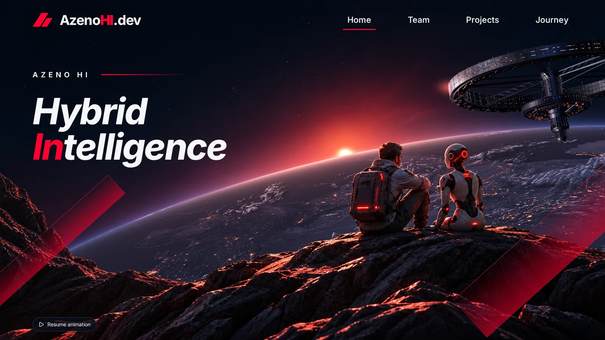
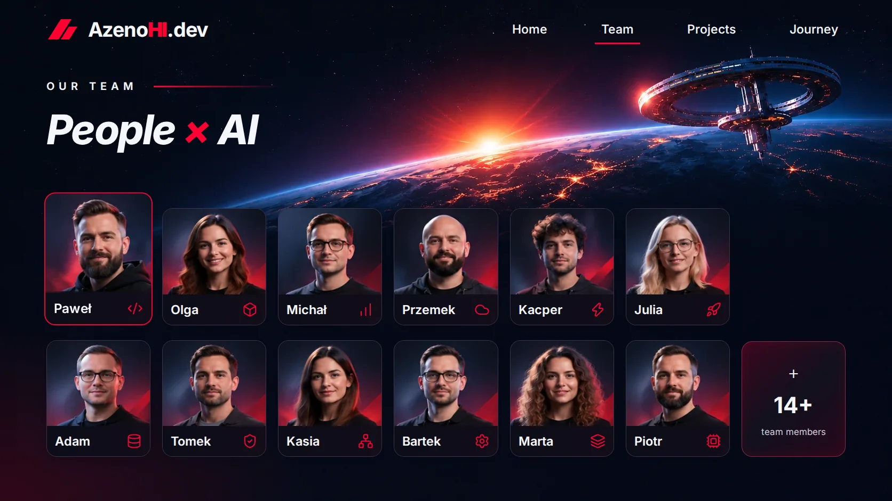
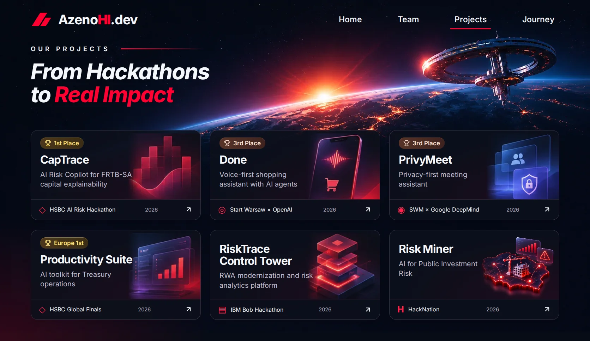
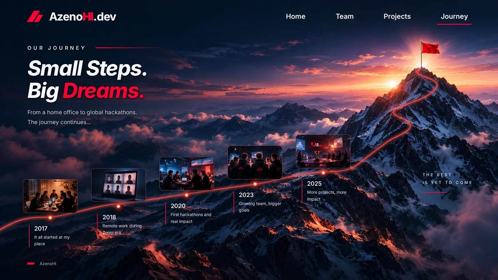
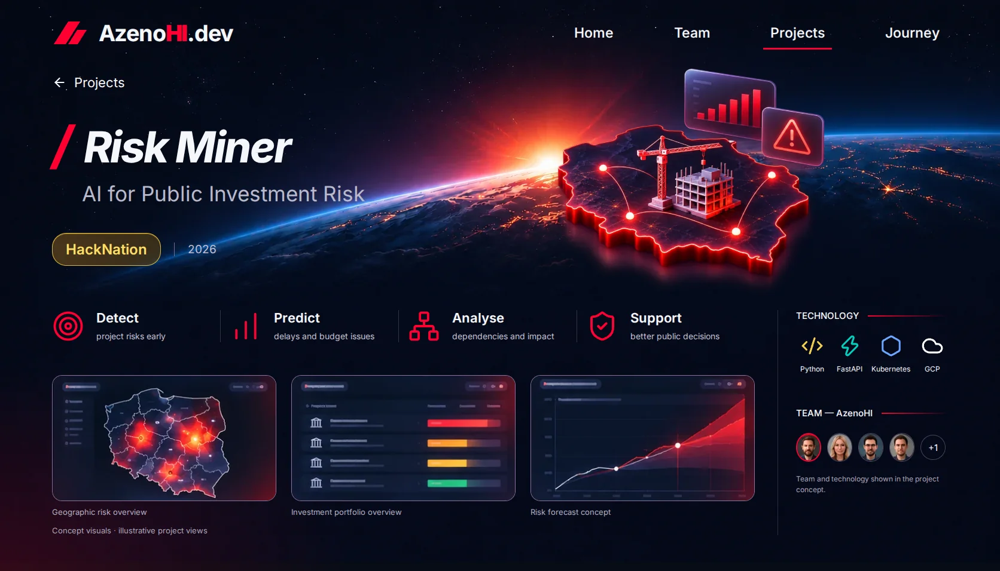

<p align="center">
  
</p>

# AzenoHI

**People × AI. From hackathons to real impact.**

A space-inspired portfolio for the AzenoHI team, presenting its people, projects
and journey. Built from the supplied visual concepts, with real HTML navigation
and a separate Three.js scene for the rotating Earth and orbital station.

<p>
  
  
  
  
  
</p>

**Status:** private, locally verified implementation. Public hosting has not been
deployed. Names, awards, membership counts and historical statements transcribed
from the concepts require owner review before public release. See
[content review](docs/content-review.md).

## Experience

- **Home** — layered artwork, independently rotating Earth and station, plated hulls,
  trusses, warm rim reflections, irregular windows, pause/resume and a static poster.
- **Team** — twelve supplied portraits and names, responsive cards and the
  reference's “14+” membership statement.
- **Projects** — six projects, with the generated Risk Miner illustration in the
  sixth card; every card opens a real, accessible local detail page.
- **Risk Miner** — project concept, Detect / Predict / Analyse / Support,
  reference screenshots, project technologies and supplied team portraits.
- **Journey** — five milestones on a mountain path, becoming a vertical timeline
  on phones.
- Keyboard navigation, skip link, mobile menu with Escape, focus management,
  semantic headings and reduced-motion support.
- WebGL, texture and context-loss fallback; rendering stops when the hero is
  outside the viewport or the browser tab is hidden.

[Watch the actual browser recording](docs/assets/recordings/scene-browser.webm)
([animated preview](docs/assets/scene-preview.webp)). The source reference MP4 is
not used by the frontend.

## Screenshots

These are captures of the implemented application, not the input mockups.
The table uses reduced motion for repeatable layout capture; the banner, mobile
Home image and browser recording show the actual procedural scene.

| Team | Projects |
| --- | --- |
|  |  |
| Journey | Risk Miner |
|  |  |

[Mobile Home](docs/assets/screenshots/home-live-mobile.webp) ·
[Mobile Team](docs/assets/screenshots/team-390.webp) ·
[Mobile Projects](docs/assets/screenshots/projects-390.webp) ·
[Mobile Journey](docs/assets/screenshots/journey-390.webp) ·
[Mobile Risk Miner](docs/assets/screenshots/risk-miner-390.webp)

## Technology

| Tool | Responsibility |
| --- | --- |
| React 19 + TypeScript 7 | Components, typed local content, strict type checks |
| Vite 8 + React Router 7 | Development, static production build, browser routing |
| Three.js + React Three Fiber | Lazy-loaded 3D geometry, shaders, frame lifecycle |
| CSS Grid / Flexbox | Responsive reference-based layouts |
| Lucide + self-hosted Inter | UI icons and typography |
| Vitest + Testing Library + R3F test renderer | Behavior, scene geometry and lifecycle tests |
| Playwright + axe | Chromium, Firefox, WebKit, mobile, accessibility and failure tests |
| Oxlint + Prettier | Type-aware lint and consistent formatting |

This website has no runtime API, database, authentication, AI service or analytics.
Python / FastAPI / Kubernetes / GCP on the Risk Miner page describe that project's
reference concept; they are not dependencies of AzenoHI.

## Getting started

Requirements: **Node.js 26.13.1** and **npm 12.2.2**, as specified by `.nvmrc` and
`web/package.json`. Use your Node version manager or the official distribution.
No environment file is needed.

```bash
npm --prefix web ci
npm --prefix web run dev
```

Development: <http://127.0.0.1:5173>. For a production build:

```bash
npm --prefix web run build
npm --prefix web run preview
```

Production preview: <http://127.0.0.1:4173>. Both ports are strict; an occupied port
is reported rather than terminating another process.

On the original workstation, a separate matching toolchain is installed at
`$HOME/.local/share/azenohi-node/bin`; add it to PATH when the shell still uses an
older Node version. This location is not required on other machines.

## Quality checks

```bash
npm --prefix web run check
npm --prefix web exec -- playwright install chromium firefox webkit
npm --prefix web run test:e2e
make spec-check
```

`check` runs type-aware lint, formatting, strict TypeScript, unit tests with
coverage, and the production build. All four coverage thresholds remain **90%**.
Browser dependencies must also be available on Linux; Playwright's
`install-deps` command can install them with system package permissions.

Verified locally: **23 unit tests** and **25 browser tests** passed. Fifteen
intentional skips are the five dedicated WebGL scenarios on the three other
browser projects; the main layout, keyboard and axe scenarios run on all four.
See [verification report](docs/verification.md) for coverage, performance,
profiles, visual review, warnings and limitations. No GitHub Actions or CI badge.

To install the local Git hooks (requires `uv`):

```bash
make hooks
```

Hooks retain lint, formatting, types, 90% unit coverage and Chromium E2E. If a
production preview already runs, point tests at that exact build:

```bash
PLAYWRIGHT_BASE_URL=http://127.0.0.1:4173 npm --prefix web run test:e2e
```

To reproduce the local performance capture with a running production preview:

```bash
node web/scripts/measure.ts
```

This writes laboratory measurements, screenshots and a browser recording under
`docs/`. Hardware/browser information in the report should be checked when
running on a different workstation.

## Project structure

```text
web/
  src/app/                 Routing and route focus
  src/components/layout/  Brand, header, shared typography and icons
  src/components/scene/   Motion policy, procedural geometry, shaders and canvas
  src/pages/               Home, Team, Projects, Journey and project details
  src/data/                Supplied content in typed modules
  src/styles/              Design tokens, typography and responsive layouts
  public/images/           Optimized production artwork
  public/textures/         Attributed Earth maps
  e2e/                     Browser and WebGL verification
  scripts/                 Reproducible measurement script
specs/001-azenohi-website/  Specification, plan, tasks and acceptance review
.specify/                  Retained Spec Kit configuration
design/                    Original references and texture masters; not served
generated_images/          Preserved generated artwork masters; not served
docs/                      Provenance, decisions, screenshots and evidence
```

Edit project, team and milestone content in `web/src/data/content.ts`. The first
five project detail views deliberately contain only the supplied descriptions;
add verified links and richer project information there when available.

The scene is a separate chunk, loaded only on Home when motion is permitted.
Repeated station plates, trusses, hardware and windows share instanced geometry.
Procedural reflection/roughness maps shade the metal; cloud occlusion and twilight
color shade Earth. A fixed underside view is separate from local station rotation.
The Earth uses terrain normals, an elevated cloud shell with a slight drift,
fine city lights and a soft dawn halo. Desktop uses 4K maps with an 8K night map;
portrait screens use 2K maps and a smaller, raised station.
See the [station comparison](docs/scene-refinement.md) and
[Earth refinement](docs/earth-refinement.md).
[Motion reference notes](docs/motion-reference.md) distinguish observation from
artistic approximations; the short source video does not establish exact periods.

Use [asset provenance](docs/assets.md) and [generation notes](docs/generated-assets.md)
when replacing artwork. Keep masters, preserve alpha, optimize variants, and
check them in the rendered cards. Never place whole mockups behind invisible links.

## Deployment preparation

`web/vercel.json` is prepared for a static Vite deployment: project root `web`,
build `npm run build`, output `dist`, and SPA rewrites for readable routes.
No deployment was performed. When hosting is explicitly requested, verify direct
entry and refresh for `/team`, `/projects`, `/journey` and `/projects/risk-miner`.
Do not introduce a `gh-pages` branch or GitHub Actions under the current policy.

## Credits and reuse

Adapted from the application starter maintained by **Paweł Konior**, used with
the user's confirmed permission. [Source revision and import process](docs/template-origin.md).
The source repository was not modified; this is an independent repository.

Earth maps: **Solar System Scope / INOVE**, [CC BY 4.0](https://creativecommons.org/licenses/by/4.0/),
converted to WebP and shaded for this scene. Inter: SIL OFL 1.1. Lucide: ISC.
Simple Icons marks: CC0. Playwright icon: Microsoft Playwright, Apache-2.0.
Relevant notices are retained in [docs/licenses](docs/licenses).

No root license was present in the approved starter, and no blanket MIT license
has been added to this code or the supplied artwork. The owner's permission to
reuse the starter does not automatically grant rights to redistribute every asset.
Review [asset provenance](docs/assets.md) and [content status](docs/content-review.md)
before public publication or reuse.
