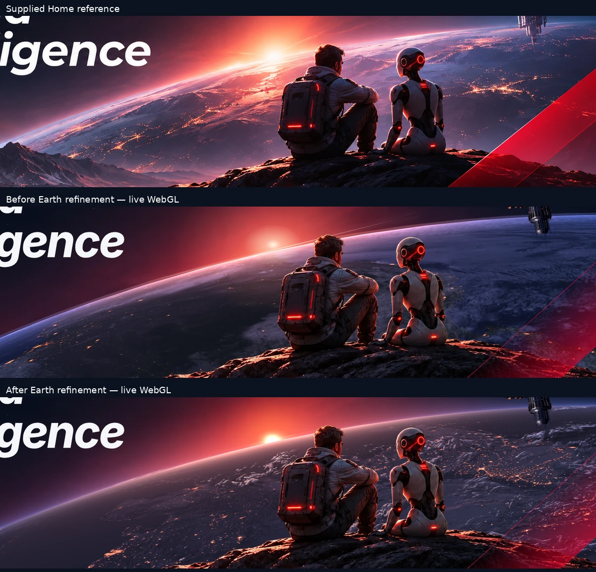

# Earth and atmosphere refinement — 24 November 2026

The follow-up requested closer Earth, cloud, city-light and horizon rendering
against the supplied Home mockup and ten-second film. The station and HTML
composition are retained from the preceding refinement.

## Browser comparison

The comparison uses the same crop of a 1672×941 viewport. The reference is
`design/reference/home.png`; the application captures are actual WebGL renders,
not the static poster. Rotating surface features vary with capture phase.
[Full before](qa/earth-refinement/before.webp) ·
[Full after](qa/earth-refinement/after.webp) ·
[Portrait](qa/earth-refinement/mobile.webp) ·
[Film detail at four seconds](qa/earth-refinement/film-detail.webp).

| Visible difference | Correction |
| --- | --- |
| Flat blue cloud sheets over dark ocean | Separate elevated cloud geometry, slope-based lighting, cool shaded faces and warm grazing highlights |
| Little surface relief | An attributed terrain normal map shades the ground independently from the cloud layer |
| Sparse/coarse city marks | Denser initial land framing and an 8K desktop night map retain finer connected networks; twilight and clouds modulate emission |
| Thin hard atmospheric edge | A soft exterior halo and an interior haze belt blend the curved silhouette into the planet |
| Point-like sun and a straight CSS flare | A world-space sunrise shader with soft bloom and a faint tangent flare; Earth occludes the lower sun |
| Fast travel of the newly visible detail | Earth period increased from the 210 s prototype to 630 s; cloud rotation is 2.5% faster, station stays at 84 s |

A final shadow-tone comparison found the ground/cloud region too dark relative
to the mockup; its cool midtones were lifted while retaining city-light contrast.

The implementation was inspected through successive browser iterations, in
portrait and at the reference desktop size. Moving captures eight seconds apart
were used to assess surface travel. The final recording and animated README
preview were regenerated from the production build.

`earthModel.ts` owns four separate objects: opaque ground, transparent displaced
clouds, an exterior atmosphere and the sunrise. The cloud map combines two
detail frequencies; the cloud shell has exaggerated relief, directional shading
and a matching drifting shadow approximation. The atmosphere fades to zero at
its outer boundary. Glow alpha also fades with radiance so the transparent canvas
does not introduce an opaque rectangle over the separate star-field image.

This remains an art-directed recreation. Texture coordinates are repeated and
offset for density/composition, rather than maintaining a geographic globe.
Clouds use a shaded surface shell, not volumetric ray marching. The source's
generated terrain, clouds and light placement cannot be reconstructed exactly
from its short clip, and the revised rotation period is an artistic choice.

## Assets and lifecycle

The new normal-map master comes from Solar System Scope / INOVE under CC BY 4.0.
Original sources are preserved; encoding details and attribution are in
[assets.md](assets.md). Desktop uses 4K day/cloud/normal maps and an 8K night map;
portrait screens retain the 2K tier. The normal map adds about 142 KB on desktop
and 10 KB on mobile; the finer desktop night map adds about 769 KB versus the
previous 4K version. Its GPU texture storage is also larger. No new runtime
dependency or remote request was added.

Cloud animation and shadow drift share the existing delta-based loop. Pause,
visibility, intersection and reduced-motion policy still govern all motion.
The additional geometry/materials are disposed on Home teardown; cached maps
remain loader-owned. Unit tests exercise both size tiers, independent cloud
drift, pause stability and disposal. The compact browser test checks all four
map requests and keeps the initial tier when the viewport is resized.

## Verification

Final results and measurement profiles are recorded in
[verification.md](verification.md), with raw logs under `docs/qa/earth-refinement/`.
The initial combined software-WebGL scenario exceeded 30 s while another browser
was simultaneously rendering comparison frames. Its assertions reached the final
navigation step; it passed in 25.6 s in isolation. Test timeouts and assertions
were preserved, and the full suite was repeated without the competing renderer.
The failure log is retained alongside the successful rerun.

Performance measurements use the same local NVIDIA GPU and unthrottled localhost
profile as earlier reports. LCP measures initial page/poster presentation, not
the completion of the 3D scene. A mobile viewport measurement is not a physical
phone benchmark. The earlier station-refinement measurements remain historical
evidence rather than results for this heavier Earth renderer.

Final local outcome: all checks pass, with 23 unit and 25 browser tests
(15 intentional WebGL skips in the other browser projects). Coverage is
99.50% statements, 98.31% branches, 98.68% functions and 99.46% lines.
The four 90% thresholds are unchanged.

| Profile | LCP | CLS | Frame cadence | Transfer |
| --- | --- | --- | --- | --- |
| Desktop 1440×900, DPR 1 | 132 ms | 0.00270 | 60 FPS; p95 16.7 ms | 3,654,597 bytes |
| Mobile viewport 390×844, DPR 2 | 268 ms | 0.0000655 | 60 FPS; p95 16.8 ms | 1,318,807 bytes |
| Reduced-motion desktop | 76 ms | 0.00270 | No animated canvas | 373,371 bytes |

The renderer was confirmed as ANGLE/NVIDIA RTX 4000 Ada Generation, Chromium
159.0.8154.6, on the Intel Xeon w5-2555X workstation. Fresh contexts, no CPU or
network throttling. All twelve Home/Projects navigation cycles removed their
canvas. Current raw data is in [performance.json](qa/performance.json); the prior
station measurements are preserved in
[performance-before.json](qa/earth-refinement/performance-before.json).
