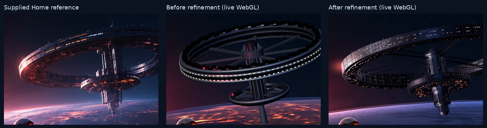

# Home scene refinement — 24 November 2026

The follow-up requested a closer match to `design/reference/home.png` and
`design/reference/animated_front_page.mp4`, particularly station geometry,
materials and lighting. The implementation remains a live Three.js scene with
independent Earth/station rotation and HTML content.

## Visual comparison

These crops use the same 472×340 region of a 1672×941 viewport. The source is the
supplied Home image; the two application captures are actual Chromium WebGL
renders. Rotation phase differs. Full captures:
[before](qa/scene-refinement/home-before.webp),
[after](qa/scene-refinement/home-after.webp),
[portrait](qa/scene-refinement/home-mobile.webp).

The [enlarged film frame](qa/scene-refinement/reference-film-station.webp), decoded
at approximately four seconds, guided the truss structure, plate seams and
industrial tower. The mockup guided composition, warm rim reflections and color.

| Observed difference | Implemented correction |
| --- | --- |
| Rounded tubes, open lower wheel and a top view | Closed bevelled annular hulls, plated docking underside and a negative X tilt |
| Undersized upper ring and long smooth spindle | Wider cropped habitat ring; stepped tower, collars, service pipes, equipment and fine aerials |
| Sparse plain spokes | Six shallow box trusses with paired rails and diagonal braces |
| Uniform bright window rows | Irregular warm/neutral window clusters, dark bays and restrained navigation beacons |
| Flat black/blue metal | Distinct armor, structural, recessed and thermal materials; procedural HDR reflections, roughness and fine bump detail |
| Uniform front lighting | Warm directional key, cool fill, Earth bounce and a localized pink rim reflection; subtle additive glint without a bloom pipeline |
| Coarse orange city streaks and hard atmospheric edge | Higher-detail Earth maps, cloud occlusion, twilight grading, fitted horizon curvature and an orthographic atmosphere shader |
| Only a small ring fragment visible on a phone | Smaller, raised station with its central module visible above the headline |

Four browser iterations corrected visible geometry, lighting and composition.
The final production build was also inspected in moving frames eight seconds
apart, at desktop and portrait sizes. Pause/resume and fallback remain available.
The [browser recording](assets/recordings/scene-browser.webm) and
[animated preview](assets/scene-preview.webp) were refreshed from the final build.

This is a procedural reconstruction. The supplied sources do not include a 3D
mesh, calibrated lights or physically consistent geography. Surface wear,
greeble placement and cloud/terrain features remain approximate; the source's
cinematic image still has richer photographic detail. The Earth shader repeats
map detail at twice its geographic density to retain fine lights without 8K GPU
textures. It should not be presented as a geographic simulation.

## Rendering and verification

Repeated parts share six instanced batches and one box geometry. Station-owned
reflection, roughness and glint maps are disposed with the scene; cached Earth
maps remain loader-owned. The fixed lighting/tilt frame is independent of the
rotating station. Animation still uses elapsed delta and the existing 210 s /
84 s artistic periods, without React state updates per frame.

Desktop maps are 4096×2048; screens initially no wider than 700 px load
2048×1024 maps. The initial tier stays fixed during resize to prevent a loading
interruption. All maps are optimized variants of attributed Solar System Scope
masters; see [asset provenance](assets.md).

- `npm --prefix web run check`: PASS; 23 unit tests, strict types, lint, formatting
  and production build. Coverage: 99.48% statements, 98.19% branches,
  98.66% functions, 99.43% lines; all 90% gates retained.
- `npm --prefix web run test:e2e`: PASS; 25 passed, 15 intentional WebGL skips in
  the other browser projects. Shared navigation, axe, keyboard and layout tests
  pass in Chromium, Firefox, WebKit and mobile Chromium.
- Real WebGL tests check independently changing Earth/station pixels, pixel-stable
  pause, resume, context loss, missing/slow assets, compact texture requests and
  retention of the compact tier during resize. Disposal tests check shared
  geometry, instancing, all owned maps and the glint material, while preserving
  borrowed Earth maps.
- `make spec-check`: PASS.

Measured with `node web/scripts/measure.ts` on the final production build,
localhost, fresh browser contexts and no CPU/network throttling. Chromium
159.0.8154.6, Intel Xeon w5-2555X, NVIDIA RTX 4000 Ada Generation; the renderer was
confirmed as ANGLE/NVIDIA. Mobile means viewport/DPR emulation on that same GPU.

| Profile | LCP | CLS | Four-second frame cadence | Resource transfer |
| --- | --- | --- | --- | --- |
| 1440×900, DPR 1 | 140 ms | 0.00270 | 60 FPS; p95 16.7 ms | 2,742,335 bytes |
| 390×844, DPR 2 | 216 ms | 0.0000655 | 60 FPS; p95 16.7 ms | 1,307,309 bytes |
| Reduced motion, desktop | 80 ms | 0.00270 | No animated canvas | 373,496 bytes |

LCP measures the immediate page/poster, not completion of 3D initialization.
Higher-detail maps increase desktop transfer relative to the previous 1.15 MB
profile; the compact tier avoids 1.44 MB of that transfer. No physical phone or
production-network measurement is claimed. The lazy scene chunk is 930 KB raw /
248 KB gzip and remains absent on reduced-motion Home and other routes.

Twelve Home/Projects navigation cycles removed every canvas. Post-GC JS heap was
6.23 MB at cycle 1 and 8.23 MB at cycle 12. This bounded observation and explicit
disposal tests do not prove zero retention in every browser/driver.

Raw evidence: [checks](qa/scene-refinement/check.log),
[browser tests](qa/scene-refinement/e2e.log),
[current measurements](qa/performance.json),
[previous measurements](qa/scene-refinement/performance-before.json).
The earlier 40-cycle memory report describes the initial scene, not this revision.
